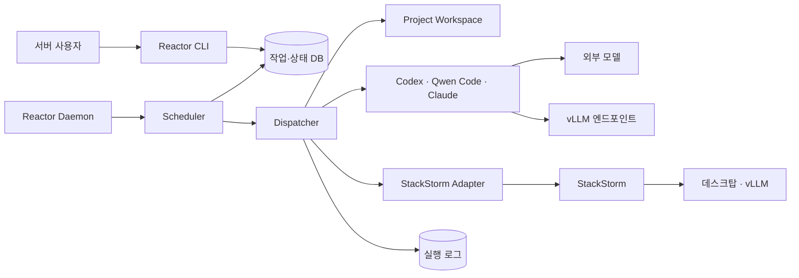

# 🚀 프로젝트: REACTOR

## 1. 기반 아이디어 (Source)

- 사용자 제공 `REACTOR` 기획서를 기반으로 프로젝트를 등록했다. 별도 초기 Idea 문서의 흡수는 지정하지 않았다.
- 여러 프로젝트의 에이전트 작업을 서버 큐에 등록하고 즉시·예약·시간대 조건에 따라 실행하는 공통 기반을 구축한다.
- 선행 인프라: [[03_Services/Personal-Stack|Personal-Stack 인프라 자동화 서비스]]. REACTOR는 작업 큐와 실행 순서를 담당하고, StackStorm은 데스크탑 전원과 vLLM 실행·종료 및 readiness 확인을 담당한다.

## 2. 최종 배포 형태 및 목표 (Definition of Done)

- **최종 형태:** Linux 서버에서 상시 실행하는 REACTOR daemon과 작업 등록·조회·취소용 CLI.
- **이번 완료 범위:** 전체 작업을 순차 실행하는 pre-release. 상세 기획과 이후 버전의 범위는 아래에 보존한다.
- **티어 판단:** 다른 프로젝트가 의존하는 핵심 인프라이며, 큐·프로세스·상태 저장과 실행기 연동의 지속 관리가 필요하므로 T4로 분류한다.
- [ ] 목표 티어: **`=this.tier`**
- [ ] Linux 서버에서 daemon과 CLI로 작업을 등록·조회·취소할 수 있다.
- [ ] Codex, Qwen Code, Claude 실행기를 공통 작업 형식으로 호출하고 결과를 수집한다.
- [ ] 즉시·예약 시각·실행 시간대 조건을 평가해 실행 가능한 작업을 선정한다.
- [ ] 모델별 정렬과 우선순위·등록 순서를 적용하며 전체 큐에서 한 번에 하나의 작업만 실행한다.
- [ ] 허용된 프로젝트 경로를 확인하고 작업 단위 잠금으로 동시 파일 수정을 제어한다.
- [ ] 대상 프로젝트의 작업 디렉터리와 에이전트 설정을 그대로 사용하는 실행 방식을 제공한다.
- [ ] 작업별 로그·종료 상태, 제한 시간·취소·재시도와 서비스 재시작 복구를 구현한다.
- [ ] 호환 실행기 하나를 통해 로컬 vLLM을 사용하고, StackStorm의 활성화·readiness·종료 흐름과 연동한다.
- [ ] 실행·설정·장애 대응·복구·점검 절차를 정리하고 서비스 전환 시 Archive와 KPT Article을 작성한다.

### 개요

**Reactor**는 에이전트 작업을 큐에 등록하고, 즉시 또는 지정된 시간에 대상 프로젝트 폴더에서 실행하는 서버용 CLI 작업 오케스트레이션 서비스다.

pre-release에서는 Codex, Qwen Code, Claude를 실행기로 지원한다. 로컬 모델은 별도 에이전트로 구현하지 않고, 세 실행기 중 로컬 모델 연결을 지원하는 하나에 vLLM 엔드포인트를 연결해 사용한다. 로컬 모델 작업 전에는 Reactor가 StackStorm에 vLLM 활성화를 요청한다.

### 목표

- 작업 지시와 대상 프로젝트 폴더를 큐에 등록한다.
- 작업을 즉시, 예약 시각 또는 지정 시간대에 실행한다.
- Codex, Qwen Code, Claude 작업을 공통 작업 형식으로 실행한다.
- 외부 모델과 로컬 vLLM 모델을 작업 설정으로 구분한다.
- pre-release에서는 큐를 모델 순서로 정렬하고 한 번에 하나의 작업만 실행한다.
- 같은 프로젝트에서 여러 작업이 동시에 파일을 수정하지 않도록 제어한다.
- 실행 로그와 성공·실패 상태를 작업별로 남긴다.
- 서비스 재시작 후에도 대기 및 실행 중 작업을 복구한다.

### pre-release 범위

- Linux 서버에서 daemon과 CLI 명령으로 동작한다.
- Codex, Qwen Code, Claude 실행기를 지원한다.
- 큐에 등록된 작업을 모델별로 묶어 설정된 모델 순서대로 실행한다.
- 전체 큐에서 한 시점에 하나의 에이전트 작업만 실행한다.
- 로컬 모델 작업은 StackStorm으로 데스크탑과 vLLM을 활성화한 뒤 실행한다.
- 작업 지시문과 대상 프로젝트 폴더를 실행기에 전달하고 종료 상태를 수집한다.
- MCP, skill, 플러그인, 도구와 에이전트별 상세 설정은 대상 프로젝트 폴더의 설정을 그대로 사용한다.

초기 Reactor는 에이전트의 내부 도구를 조립하거나 관리하지 않는다. task 단위 작업을 큐 규칙에 따라 적절한 실행기에 전달하고 실행 생명주기를 관리하는 데 책임을 한정한다.

### 책임 경계

#### Reactor가 담당하는 것

- 작업 등록, 예약, 취소
- 실행 가능한 작업 선정과 모델순 정렬
- 대상 프로젝트 폴더 확인과 작업 단위 잠금
- 에이전트 프로세스 실행, 제한 시간, 재시도, 상태 추적
- 기본 실행 로그와 종료 상태 저장
- StackStorm 인프라 액션 호출

#### 각 프로젝트가 담당하는 것

- 에이전트별 지침과 작업 규칙
- MCP 서버, skill, 플러그인 및 기타 도구 설정
- 프로젝트에서 허용할 명령과 권한
- 빌드, 검사 및 결과물 생성 방식

Reactor는 이 설정을 해석하거나 공통 형식으로 변환하지 않는다. 에이전트 실행기의 작업 디렉터리를 해당 프로젝트 폴더로 지정해 그 프로젝트의 설정이 적용되게 한다.

#### StackStorm이 담당하는 것

- 데스크탑 부팅 및 부팅 완료 확인
- 지정한 vLLM 컨테이너 실행 및 API 준비 상태 확인
- vLLM 컨테이너 종료
- 유휴 조건을 만족한 데스크탑 종료

StackStorm은 작업 큐와 에이전트 실행 순서를 알 필요가 없다. Reactor가 실행 순서를 결정한 뒤 로컬 모델에 필요한 인프라 명령만 요청한다.

### 주요 사용 흐름

1. 사용자가 CLI로 작업 폴더, 지시문, 에이전트, 모델, 실행 시점을 등록한다.
2. Scheduler가 실행 조건을 만족한 작업을 모델별로 묶고 설정된 모델 순서로 정렬한다.
3. Reactor가 큐의 첫 작업을 선택해 대상 프로젝트 폴더를 잠근다.
4. 외부 모델 작업은 지정한 에이전트 실행기를 바로 시작한다.
5. 로컬 모델 작업은 StackStorm에 데스크탑 부팅과 vLLM 활성화를 요청하고 readiness 완료를 기다린다.
6. Reactor가 프로젝트 폴더에서 에이전트 실행 명령을 시작한다. MCP와 도구는 에이전트가 프로젝트 설정에 따라 직접 불러온다.
7. Reactor가 종료 코드와 로그를 기록하고 폴더 잠금을 해제한 뒤 다음 작업을 실행한다.
8. 같은 로컬 모델의 대기 작업이 없으면 정책에 따라 vLLM과 데스크탑을 종료한다.

### 구조



| 구성 요소 | 책임 |
|---|---|
| Reactor CLI | 작업 등록, 조회, 취소 및 daemon 제어 |
| Reactor Daemon | 큐를 계속 감시하고 실행 생명주기 관리 |
| Scheduler | 즉시·예약·시간대 조건 평가와 모델순 정렬 |
| Dispatcher | 폴더 잠금, 실행기 호출, 상태 전이 |
| Agent Adapter | 세 실행기의 시작·종료·취소 방식을 통일 |
| Project Workspace | 프로젝트 자체 MCP와 도구 설정 제공 |
| Local Resource Manager | vLLM 활성화 요청과 로컬 모델 전환 판단 |
| StackStorm Adapter | 전원 및 컨테이너 액션 호출과 준비 상태 확인 |
| State Store | 대기 작업, 현재 실행 상태, 기본 실행 로그 저장 |

### 작업 정의

```yaml
task_id: uuid
workspace: /workspaces/example
instruction: "의존성을 갱신하고 변경 내용을 정리한다"
agent: codex                 # codex | qwen-code | claude
model: model-id
model_runtime: external      # external | local_vllm
execution:
  mode: scheduled            # immediate | scheduled | time_window
  not_before: 2026-09-12T02:00:00+09:00
  window_end: 2026-09-12T06:00:00+09:00
priority: 50
timeout_seconds: 3600
max_attempts: 2
idempotency_key: optional-key
```

pre-release 상태 흐름은 다음과 같이 단순화한다.

`QUEUED → PREPARING → RUNNING → SUCCEEDED | FAILED | CANCELLED`

실행 프로세스에는 lease와 heartbeat를 부여한다. 프로세스가 중단되면 만료된 lease를 회수하고 정책에 따라 다시 대기시키거나 실패 처리한다.

### 프로젝트 폴더 정책

- 설정에 등록된 루트 아래의 폴더만 실행 대상으로 허용한다.
- 에이전트 프로세스의 작업 디렉터리를 지정된 프로젝트 폴더로 설정한다.
- MCP, 도구, skill과 에이전트 지침은 해당 프로젝트 폴더에 둔다.
- Reactor는 프로젝트 설정을 에이전트별 공통 형식으로 변환하지 않는다.
- pre-release에서는 같은 프로젝트의 작업을 동시에 실행하지 않는다.
- API 키와 SSH 키는 작업 입력이나 로그에 저장하지 않고 환경 또는 secret 경로로 전달한다.

### pre-release 큐 정책

전체 작업은 순차 실행한다. Scheduler는 실행 가능한 작업을 `model_order` 설정에 따라 모델별로 정렬하고, 같은 모델 안에서는 우선순위와 등록 순서를 사용한다.

```yaml
model_order:
  - local-qwen-model
  - claude-model
  - codex-model
```

1. 실행 시점이 된 작업만 실행 가능 큐로 이동한다.
2. 같은 모델 작업을 하나의 묶음으로 정렬한다.
3. 현재 모델 묶음을 순차 처리한 뒤 다음 모델 묶음으로 이동한다.
4. 묶음 실행 중 들어온 작업은 다음 정렬 주기에 반영해 한 모델이 큐를 계속 점유하지 않게 한다.
5. 로컬 vLLM은 해당 모델 묶음을 시작하기 전에 한 번 활성화하고 묶음이 끝난 뒤 종료한다.

### 로컬 모델과 StackStorm

pre-release에서 로컬 모델은 Codex, Qwen Code, Claude 중 설정상 호환되는 실행기 하나에 연결한다. 작업의 `agent`는 실행할 CLI를 나타내고, `model_runtime: local_vllm`은 모델 제공자가 로컬 vLLM임을 나타낸다.

Reactor는 로컬 작업을 시작하기 전에 StackStorm을 호출한다. 이 방식은 초기 구현의 명시적인 의존성이며, 이후 다른 추론 서버와 전원 관리 수단을 지원할 수 있도록 adapter 경계로 둔다.

| StackStorm 액션 | 기대 결과 |
|---|---|
| `desktop.ensure_online` | WOL 실행 후 SSH 또는 health check 성공 |
| `desktop.ai.activate(model)` | 대상 vLLM 컨테이너 실행과 API readiness 확인 |
| `desktop.ai.stop(model)` | 대상 vLLM API 종료 완료 |
| `desktop.shutdown` | 로컬 작업과 vLLM이 정리된 뒤 PC 종료 |

각 요청에는 `request_id`를 넣어 중복 호출에도 같은 결과를 반환하도록 한다. `activate` 성공 응답은 컨테이너 시작이 아니라 실제 inference API readiness가 확인된 시점에 반환한다.

### CLI 초안

- `reactor daemon start` — 큐 처리 daemon 시작
- `reactor task add` — 작업 등록
- `reactor task show <task-id>` — 작업 상태와 로그 확인
- `reactor task cancel <task-id>` — 대기 또는 실행 작업 취소
- `reactor queue show` — 현재 대기 순서 확인
- `reactor agents` — 설정된 에이전트와 모델 확인
- `reactor local status` — 데스크탑과 활성 vLLM 상태 확인

CLI는 로컬 socket 또는 상태 DB를 통해 daemon과 통신한다. HTTP API와 웹 UI는 pre-release 범위에 포함하지 않는다.

### pre-release 완료 기준

1. 서버에서 지속 실행되는 Reactor daemon과 CLI
2. Codex, Qwen Code, Claude 실행기 연결
3. 즉시 실행, 예약 시각, 실행 시간대 지원
4. 모델순 정렬과 전체 순차 실행
5. 허용 경로 검증과 프로젝트별 실행 잠금
6. 프로젝트 폴더의 MCP와 도구 설정을 그대로 사용하는 실행 방식
7. 기본 실행 로그, 제한 시간, 취소, 재시도, 재시작 복구
8. StackStorm을 통한 로컬 vLLM 활성화와 종료

### 이후 버전

- 외부 모델 작업 병렬 실행
- 프로젝트별 동시성 및 자원 제한 정책
- 완료 작업 목록, 검색, 상세 결과와 산출물 조회
- HTTP API와 웹 UI
- Git worktree 또는 컨테이너 기반 작업 격리
- StackStorm 이외의 전원 관리자와 vLLM 이외의 추론 서버 지원
- 여러 GPU와 여러 로컬 실행 노드 지원
- 작업 DAG와 후속 작업 연결

초기 범위에서는 에이전트용 MCP·도구·skill의 중앙 관리, 실시간 채팅 프록시, 외부 모델 병렬 처리, 복잡한 작업 DAG, 다중 GPU를 제외한다.

### 이후 결정할 항목

- 구현 언어와 영속 큐: 예시로 Python + PostgreSQL 또는 SQLite
- 세 에이전트별 CLI 호출 및 인증 방식
- 로컬 vLLM과 연결할 에이전트 실행기
- 모델 정렬 순서와 큐 재정렬 시점
- daemon 관리 방식: systemd 또는 컨테이너
- 사용자 활동을 판단하는 신호와 야간 실행 시간대
- 작업별 명령 권한과 자동 커밋 범위
- 로그 보존 기간

### 참고

OpenAI Responses API는 비동기 background 실행과 개발자가 정의한 도구 호출을 지원한다. Codex 연동 방식을 API로 확장할 때 참고할 수 있지만, Reactor가 작업 상태와 폴더 실행 권한의 최종 소유자가 된다. 자세한 내용은 [OpenAI Responses API](https://developers.openai.com/api/reference/cli/resources/responses/methods/create)를 참고한다.

## 3. 마일스톤 및 태스크 (WIP Limit 체크)

2026-09-11 Personal-Stack 초기 구축이 완료되어 서비스로 전환되었다. 기존 StackStorm 프로젝트의 T4 WIP 점유는 해제되었다. REACTOR는 기획 상태(`Planning`)를 유지하며 착수 시 현재 T4 활성 작업과 연동 계약을 확인한다. 기한은 아직 정하지 않았다.

- [ ] **마일스톤 1: 실행 계약과 기술 선택 확정**
  - [ ] 구현 언어, 영속 큐·DB, daemon 관리 방식과 CLI 통신 방식을 선택한다.
  - [ ] 세 실행기의 호출·인증·취소 방식과 로컬 vLLM 호환 실행기를 확인한다.
  - [ ] 작업 상태, lease·heartbeat, 재시도·중복 요청 처리 및 재시작 복구 정책을 확정한다.
  - [ ] 모델 정렬 주기, 실행 시간대, 명령 권한·자동 커밋 범위와 로그 보존 기간을 결정한다.
- [ ] **마일스톤 2: 영속 큐와 스케줄러 구현**
  - [ ] 작업 등록·조회·취소 및 daemon 제어 CLI를 구현한다.
  - [ ] 즉시·예약·시간대 조건과 모델별 묶음·우선순위·등록 순서 정책을 구현한다.
  - [ ] 전체 순차 실행과 새로 들어온 작업의 다음 정렬 주기 반영을 구현한다.
- [ ] **마일스톤 3: 프로젝트 폴더와 실행기 연결**
  - [ ] 허용 루트·프로젝트 경로 확인과 폴더 잠금을 구현한다.
  - [ ] 세 실행기의 adapter와 프로젝트 작업 디렉터리 전달을 구현한다.
  - [ ] 프로젝트 설정을 유지하면서 작업별 로그·종료 상태를 수집한다.
  - [ ] 제한 시간, 실행 중 취소, 재시도 및 재시작 시 상태 복구를 구현한다.
- [ ] **마일스톤 4: StackStorm·로컬 모델 연동**
  - [ ] 전원·vLLM 액션의 요청·응답과 `request_id` 계약을 맞춘다.
  - [ ] API readiness 이후에만 로컬 작업을 실행하도록 연결한다.
  - [ ] 모델 묶음 단위 활성화·종료와 데스크탑 유휴 종료 조건을 구현한다.
- [ ] **마일스톤 5: pre-release 배포와 서비스 인계**
  - [ ] Linux 서버 배포 설정과 인증정보 전달 방식을 정리한다.
  - [ ] 완료 기준별 확인 결과와 미완료 사항을 기록한다.
  - [ ] 운영·복구 매뉴얼과 유지보수 주기를 정하고 `03_Services`에 인계한다.
  - [ ] 완료 프로젝트를 아카이빙하고 KPT 아티클과 후속 Idea를 연결한다.

## 4. 리소스 및 참고 자료 (PARA's Resource)

- 원본 기획서의 개요, 책임 경계, 작업 스키마, 큐 정책, CLI 초안과 미결정 항목은 이 문서의 2절에 보존했다.
- 선행 서비스: [[03_Services/Personal-Stack]]
- 선행 구축 기록: [[04_Archives/Personal-Stack/Project]]
- 프로젝트 컨텍스트 게시 가이드: [[05_ProjectContexts/README]]
- 서비스 전환 템플릿: [[99_Templates/Template_Service]]
- 개발 저장소와 로컬 작업 경로: 미정.

## 5. 일일 개발 브리핑

- 브리핑 ID는 `reactor`다.
- 개발을 시작해 `status: In_Progress`로 바꿀 때 `05_ProjectContexts/reactor`에 `.brief`와 선택한 Task 문서 폴더를 게시한다.
- `05_ProjectContexts/reactor/.brief/brief.md`는 필수이며 브리핑은 로컬 개발 폴더가 아니라 Vault 컨텍스트만 읽는다.
- 개발 프로젝트에서 같은 문서를 직접 편집하려는 기기만 `.aps.local.json`에 경로와 `mounts`를 등록하고 `05_ProjectContexts/README.md`에 따라 로컬 링크를 만든다.
